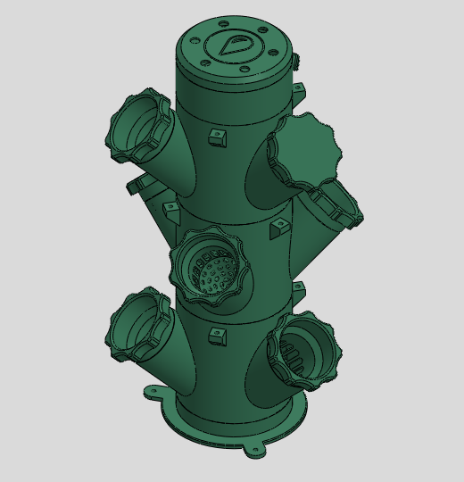
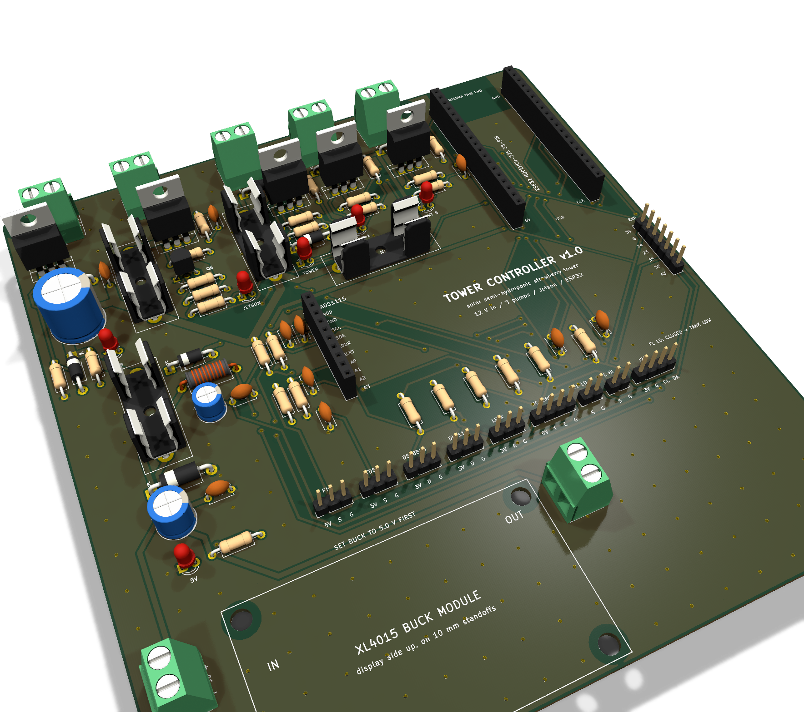
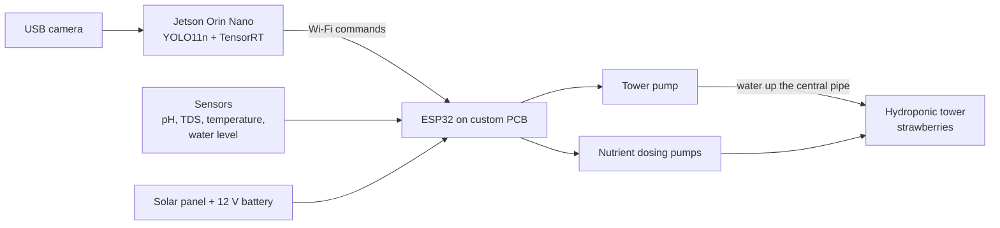

# Smart Hydroponic System

**A vertical hydroponic tower for strawberries that spots plant diseases with a camera and AI, and adjusts nutrient dosing automatically.**

Bachelor project · Ahmed Mohamed Elanany

  
  &nbsp;&nbsp;
  

---

## The idea

Plant diseases spread fast in hydroponic systems, and people often notice them too late. This system checks the plants with a camera all the time. When the AI model sees disease or anything unusual on a plant, it triggers the nutrient dosing pumps automatically.

## How it works

1. **Watch:** a camera monitors the strawberry plants in the tower.
2. **Detect:** a YOLO11n model on the Jetson Orin Nano checks each image for signs of disease.
3. **Act:** the ESP32 controller switches the nutrient dosing pumps and the tower pump, and turns the Jetson on only when it is needed.
4. **Power:** everything runs from a solar panel and a 12 V battery.

## Tower design (SolidWorks)

- **Modular:** twist-lock modules that stack on top of each other, so the tower can grow or be repaired one section at a time.
- **Top-feed water system:** water rises through a central pipe and is spread from the head to every module.
- **Every plant is independent:** each pocket gets water directly, so lower plants never depend on the plants above them.
- **Semi-hydroponic pockets:** plants sit in pots with growing medium, designed so water flows through every plant without blocking.

The twist-lock concept is based on an open-source modular tower design (Modular Hydroponic Tower Garden REMASTERED).

## PCB design

I design my own PCBs. The tower controller board was designed from scratch in **KiCad**: schematic, layout, custom footprints and manufacturing files.

- Two-layer through-hole board, 150 × 160 mm
- 12 V battery input with reverse-polarity protection (P-MOSFET), TVS diode and a fuse for each branch
- Three MOSFET-switched pump outputs and a high-side switch for the Jetson
- ESP32 socket, ADS1115 ADC for pH, TDS and battery voltage, connectors for all sensors
- Mount for an XL4015 buck module (5 V)
- Hardware dry-run protection: the low-water float switch blocks the tower pump even if the software tries to run it

Files: [`pcb/`](pcb) (KiCad project, schematic PDF, parts list, Gerbers).

## AI model

| | |
| --- | --- |
| Model | YOLO11n, trained on 9 strawberry disease / healthy classes |
| Accuracy | mAP50 **0.881** on the test split |
| Jetson Orin Nano | TensorRT FP16, about **12 ms** per image |

Details: [`ai/results.md`](ai/results.md).

## Repository

| Folder | What is inside |
| --- | --- |
| [`esp32/`](esp32) | ESP32 firmware for the tower controller (Arduino), sensor test sketches and wiring notes |
| [`jetson/`](jetson) | Jetson ↔ ESP32 link test |
| [`ai/`](ai) | Training notebook (Google Colab), training results and the trained weights |
| [`sim/`](sim) | MATLAB scripts and the Simulink model (solar energy, battery, water flow, tank) |
| [`pcb/`](pcb) | KiCad files of the tower controller board |
| [`images/`](images) | Pictures used in this README |

## Tech

| Area | Tools |
| --- | --- |
| AI / vision | Python, YOLO11n, TensorRT, NVIDIA Jetson Orin Nano |
| Embedded | ESP32 (C/C++, Arduino), Wi-Fi web interface, ADS1115 |
| PCB design | KiCad |
| Mechanical design | SolidWorks |
| Simulation | MATLAB / Simulink |
| Power and pumps | Solar panel, 12 V battery, tower pump, nutrient dosing pumps |

## Status

In development: the controller board is built and in testing, the AI model runs on the Jetson, and the tower is being prepared for printing.

## Author

**Ahmed Mohamed Elanany** · [LinkedIn](https://www.linkedin.com/in/ahmed-elanany) · ahmedelanany34@gmail.com
