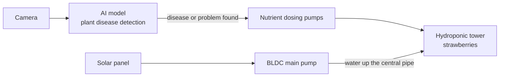

# Smart Hydroponic System

**A vertical hydroponic tower for strawberries that spots plant diseases with a camera and AI, and adjusts nutrient dosing automatically.**

Personal project · Ahmed Mohamed Elanany

---

## The idea

Plant diseases spread fast in hydroponic systems, and people often notice them too late. This system checks the plants with a camera all the time. When the AI model sees disease or anything unusual on a plant, it triggers the nutrient dosing pumps automatically.

## How it works

1. **Watch:** a camera monitors the strawberry plants in the tower.
2. **Detect:** an AI vision model checks each image for signs of disease or stress.
3. **Act:** when something is wrong, the controller switches on the nutrient dosing pumps.
4. **Circulate:** a solar-powered BLDC pump moves water through the whole tower, separate from the dosing pumps.

## Tower design (SolidWorks)

- **Modular:** separate sections that stack on top of each other, so the tower can grow or be repaired one section at a time.
- **Top-feed water system:** water rises through a central pipe with no side holes and is then distributed to the pockets.
- **Every plant is independent:** each pocket gets water directly, so lower plants never depend on the plants above them.
- **Semi-hydroponic pockets:** plants sit in pockets with growing medium, designed so water flows through every plant without blocking.

## Tech

| Area | Tools |
| --- | --- |
| AI / vision | Python, image-based disease detection model |
| Mechanical design | SolidWorks (2024) |
| Power and pumps | Solar panel, BLDC main pump, separate dosing pumps |

## Status

In development: the tower is being designed in SolidWorks, and the AI model and pump control are being built. Photos, the CAD files and the code will be added here.

## Author

**Ahmed Mohamed Elanany** · [LinkedIn](https://www.linkedin.com/in/ahmed-elanany) · ahmedelanany34@gmail.com
